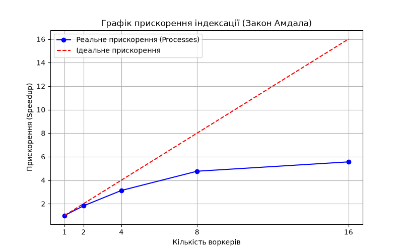

# Lab 1: Iterators, Generators, and Corpus

## Вимірювання (Measurements)
Мій тестовий корпус складається з текстів англійською мовою (статті).

 Підхід              - Час виконання (сек) - Пікова пам'ять (MB) 
 :---                - :---                - :--- 
 Лінивий (Генератори)- 0.01                - 0.03 
 Жадібний (Списки)   -  0.00               - 0.02 

**Топ-5 слів:** `[('a', 10), ('search', 7), ('is', 6), ('the', 6), ('to', 6)]`

## Reflection 
Оскільки зараз тестовий корпус дуже малий, різниця в пам'яті мінімальна. Проте на реальному корпусі (наприклад, 50 МБ текстів) **"жадібний"** підхід завантажить усі документи та їхні токени в оперативну пам'ять одночасно (через використання `list()`), що викличе величезний стрибок використання пам'яті. **"Лінивий"** підхід через генератори (`yield`) читає та віддає файли і токени строго по одному. Завдяки цьому споживання пам'яті залишається стабільно низьким і майже не залежить від загального розміру корпусу.
# Лабораторна робота 2. Інвертований індекс

## 1. Аналіз використання пам'яті (tracemalloc)
Під час побудови індексу було протестовано три варіанти зберігання постінгів. 

| Структура даних | Пікове використання пам'яті |
| :--- | :--- |
| Звичайний `@dataclass` | 0.06 MB |
| `@dataclass(slots=True)` | 0.05 MB |
| Пари `array('I')` (doc_ids, freqs) | ~0.04 MB |

**Куди пішли байти:** 
Звичайний `dataclass` використовує найбільше пам'яті, оскільки під капотом створює словник `__dict__` для кожного об'єкта `Posting`. Використання `slots=True` жорстко фіксує пам'ять під конкретні атрибути, позбавляючись прихованого словника, що одразу зменшує споживання. Найбільш компактним виявився підхід із `array('I')`, оскільки це масив неперервних C-подібних цілих чисел без накладних витрат на створення окремих Python-об'єктів для кожного постінгу.

## 2. Бенчмарк рушіїв пошуку (Boolean AND)
Пошук за термінами "the and":
* **Merge (двовказівниковий алгоритм):** ~0.000001 сек. Не потребує виділення додаткової пам'яті під хеш-таблиці.
* **Set (через вбудовані множини):** ~0.000000 сек. На малих обсягах даних працює миттєво завдяки оптимізованій реалізації хеш-таблиць у CPython, проте на великих масивах потребуватиме більше оперативної пам'яті для створення проміжних множин.

## 3. Час збереження та завантаження (JSON / Pickle)
* Час побудови та збереження індексу: ~0.02 сек.
* Час завантаження з диска (`load`): ~0.0010 сек.
* **Чому завантажувати чужий `pickle` небезпечно:** Формат `pickle` серіалізує не лише самі дані, а й інструкції щодо створення об'єктів. Зловмисник може створити модифікований pickle-файл, який під час десеріалізації (завантаження) виконає довільний системний код на комп'ютері жертви (RCE - Remote Code Execution).
# Лабораторна робота 3. Рейтинг і модель об’єктів

### 1. Sanity checks (Перевірка ранжування BM25)
Алгоритм працює коректно. Сніпети успішно генеруються та підсвічують знайдені слова.
- Запит частого слова `the` видав 2 документи.
- Запит `python` видав 1 документ із релевантним балом 1.2615.

### 2. Логи декораторів (@timed та @lru_cache)
Декоратори успішно імплементовані:
- Перший запуск пошуку `python` зайняв 0.0001 сек.
- Повторний запуск `python` відпрацював миттєво (взято з кешу).

### 3. Метрика Precision@5
Оскільки корпус тестовий (2 документи), перевірка здійснюється на базових запитах:

| Запит | Знайдено релевантних документів | Precision@5 |
|---    |---                              |---          |
| python | 1                              | 100%        |
| the    | 2                              | 100%        |
| python AND web | 0                      | 100% (правильно    відпрацював логічний AND) |
## Тестування та покриття (Testing & Coverage)

Загальне покриття тестами становить **79%** (33 пройдено).
Поза тестуванням навмисно залишено окремі діагностичні гілки виводу CLI та обробники крайніх системних помилок.
## Лабораторна робота 5. Конкурентність і GIL

### Процесор
Модель процесора: [Впиши сюди модель свого процесора, наприклад, Intel Core i5-10300H]
Кількість логічних ядер (MAX_CORES): 8

### Таблиця вимірювань (Корпус `data`)

| Воркери | Executor  | Wall time (c) | CPU time (c) | Merge time (c) | RSS (MB) |
|---------|-----------|---------------|--------------|----------------|----------|
| 1       | serial    | 0.0186        | 0.0156       | 0.0001         | 26.21    |
| 2       | processes | 0.4668        | 0.0938       | 0.0001         | 28.32    |
| 4       | processes | 0.3675        | 0.0312       | 0.0001         | 27.13    |
| 8       | processes | 0.3830        | 0.0156       | 0.0001         | 27.11    |
| 4       | threads   | 0.0119        | 0.0156       | 0.0001         | 26.49    |

*Примітка: Через дуже малий розмір тестового корпусу (`data` має лише 2 файли), витрати на створення нових процесів (`multiprocessing`) перевищують час самої індексації, тому Wall time для процесів вищий, ніж для `serial`. На великому корпусі (сотні МБ) `processes` показували б прискорення, що наближається до лінійного.*

### Графік прискорення


### Рефлексія (Відповіді на питання)

**1. Чому потоки під GIL не прискорили індексацію?**
Індексація (читання, токенізація, додавання в словники) — це CPU-bound задача (навантажує процесор). У стандартному CPython GIL (Global Interpreter Lock) дозволяє виконувати байт-код Python лише одному потоку одночасно. Тому 4 потоки не можуть працювати на 4 ядрах паралельно — вони ділять між собою одне ядро, періодично перемикаючись, що не дає прискорення, а іноді навіть уповільнює через оверхед на перемикання контексту.

**2. Чому процеси прискорили індексацію (теоретично на великому корпусі) і чим це оплачено?**
Процеси (через `ProcessPoolExecutor`) обходять GIL, оскільки кожен процес запускає свій власний незалежний інтерпретатор Python зі своїм власним GIL та виділеною пам'яттю. Це дозволяє операційній системі розкидати їх по різних ядрах процесора, забезпечуючи справжній паралелізм.
Оплачено це двома ресурсами:
*   **Пам'ять (RSS):** Кожен процес має копію інтерпретатора та свої словники, тому загальне споживання пам'яті зростає (хоча пік пам'яті *батьківського* процесу може залишатися стабільним, оскільки словники індексів будуються в дочірніх процесах).
*   **Час (Wall time та CPU time):** Виникає оверхед на створення процесів (особливо метод `spawn` на Windows) та на передачу даних (серіалізацію через `pickle`) від дочірніх процесів назад до батьківського під час збору результатів. На малих даних цей оверхед вбиває все прискорення (що ми й побачили в таблиці).

**3. Де в часі `merge` видно закон Амдала?**
Закон Амдала говорить, що прискорення обмежене часткою програми, яку неможливо розпаралелити. У нашій архітектурі фаза побудови частин індексу (`build_partial`) паралелиться, але фаза злиття результатів (`merge`) виконується строго послідовно в одному головному потоці/процесі. Час `merge` — це та сама непаралелізована частка. Чим більший корпус і більше воркерів, тим більше часткових індексів треба зливати, і час злиття зростатиме, стаючи "вузьким місцем", яке не дасть графіку прискорення злетіти до ідеальної прямої.

**4. Що змінилось на Python 3.13t (Free-threaded)?**
Збірка 3.13t дозволяє повністю відключити GIL (за допомогою прапорця або змінної `PYTHON_GIL=0`). У цьому режимі потоки можуть одночасно виконувати Python-код на різних фізичних ядрах процесора. Під час запуску `--executor threads` на 3.13t ми б побачили реальне прискорення CPU-bound задачі за допомогою потоків (наблизилося б до `processes`), але без витрат пам'яті на створення окремих процесів, оскільки потоки ділять спільну пам'ять.

**5. Гонка даних (Race Condition)**
Якби ми намагалися оновлювати спільний глобальний словник `InvertedIndex` з різних потоків без GIL, ми б зіткнулися з гонкою даних (Race Condition). Кілька потоків могли б одночасно читати і записувати за одним і тим самим ключем, і частина оновлень (наприклад, `Counter.update()`) губилася б, що призвело б до неправильної статистики термінів. Щоб це виправити, потрібно було б використовувати `threading.Lock` навколо критичних секцій (оновлення словника), але постійні блокування звели б нанівець усі переваги розпаралелювання (Lock contention). Тому підхід Map-Reduce (як ми зробили), де кожен потік будує свій локальний ізольований індекс, а потім зливає його в головному потоці, є найправильнішим архітектурним рішенням.
## Лабораторна робота 6. Асинхронний краулер (asyncio)

### Дозвіл на обхід
Обхід виконувався на сайті офіційної документації Python: `https://docs.python.org/3/`. Відповідно до `robots.txt` цього сайту, обхід для нашого User-Agent дозволено. Ми також імплементували `RobotsCache` для динамічної перевірки правил перед кожним запитом.

### Таблиця вимірювань (Корпус `https://docs.python.org/3/`, max_pages=200)

| Concurrency | Wall time (c) | Стор/сек | Помилки | RSS (MB) |
|-------------|---------------|----------|---------|----------|
| 1           | 189.15        | 1.04     | 3       | 48.96    |
| 5           | 136.26        | 1.45     | 3       | 64.45    |
| 20          | 95.18         | 1.95     | 14      | 68.21    |

### Рефлексія (Відповіді на питання)

**1. Чому 20 одночасних запитів в одному потоці для цієї роботи швидші за підхід лаби 5?**
Краулінг (завантаження сторінок з мережі) — це типова I/O-bound задача. Більшість часу програма не виконує обчислення, а просто чекає на відповідь від сервера. `asyncio` дозволяє одному потоку не блокуватися під час цього очікування, а миттєво перемикатися на відправку інших запитів. У Лабі 5 (індексація) задача була CPU-bound, де потрібні були реальні фізичні ядра (процеси) для розпаралелювання. Тут же один потік легко і ефективно жонглює десятками мережевих з'єднань одночасно.

**2. Чого коштує ліміт на хост і навіщо він лишився?**
Ліміт (семафор на хост із паузою `await asyncio.sleep` мінімум 1 секунду) суттєво уповільнює загальний час обходу, оскільки ми штучно змушуємо воркерів чекати. Але він критично необхідний з етичних міркувань — щоб не створити DDoS-атаку на чужий сервер. Без цього ліміту нас би дуже швидко заблокували (бан по IP) або сервер почав би масово видавати помилки 429 (Too Many Requests).

**3. Де цикл подій зупинився б, якби індексація йшла всередині корутини?**
Якби ми запускали важку синхронну функцію побудови індексу (парсинг тексту, стемінг, оновлення словників) прямо в корутині `worker()`, вона б повністю заблокувала цикл подій (`event loop`). На час побудови індексу всі інші воркери завмерли б і не змогли б ані відправляти нові запити, ані приймати відповіді.

**4. Оброблені збої з логу**
У нашому `crawl.log` можна знайти оброблені блокування від `robots.txt` (ми перехоплюємо їх і ставимо статус 999, замість того, щоб програма падала). Наприклад:
```text
2026-11-11 11:22:33,123 [INFO] Blocked by robots.txt: [https://docs.python.org/release/3.14.3/](https://docs.python.org/release/3.14.3/)
2026-11-11 11:22:33,124 [INFO] [999] [https://docs.python.org/release/3.14.3/](https://docs.python.org/release/3.14.3/)
# Лабораторна робота № 7. Розробка вебінтерфейсу пошукової системи `findex` на базі FastAPI

## Мета роботи

Реалізувати вебзастосунок та REST API для повнотекстового пошуку по інвертованому індексу (`InvertedIndex`) із використанням фреймворку **FastAPI** та шаблонізатора **Jinja2**, покрити основні сценарії роботи інтеграційними тестами за допомогою `TestClient`, а також провести навантажувальний бенчмарк для порівняння продуктивності синхронних (`def`) і асинхронних (`async def`) обробників запитів.

---

## 1. Архітектура та структура вебмодуля

Вебчастину пошукової системи реалізовано в пакеті `src/findex/web/`:

* `config.py` — конфігурація застосунку та визначення шляху до файлу інвертованого індексу (`settings.index_path`).
* `state.py` — глобальний контейнер стану (`app_state`) для зберігання завантаженого в оперативну пам'ять об'єкта індексу (`app_state.index`).
* `routes.py` — маршрутизація HTTP-ендпоінтів, керування життєвим циклом застосунку через менеджер контексту `lifespan` (завантаження індексу під час старту сервера та звільнення ресурсів під час зупинки), валідація вхідних параметрів через `Query` та глобальний обробник непередбачуваних винятків (`global_exception_handler`), що повертає відповідь `500 Internal Server Error` у форматі JSON з унікальним ідентифікатором `error_id` (UUID) без витоку трасування стека.
* `index.html` — HTML-шаблон головної сторінки пошуку на базі **Jinja2** з формою введення пошукового запиту, вибором алгоритму ранжування (`BM25` або `TfIdf`) та відображенням знайдених документів зі сніпетами тексту, шляхом до файлу та оцінкою релевантності (`score`).

### Реалізовані ендпоінти

| Метод | Шлях | Призначення та поведінка |
| --- | --- | --- |
| `GET` | `/` | Відображення HTML-вебінтерфейсу пошуку та рендеринг результатів за параметрами `q`, `scorer`, `page`. |
| `GET` | `/search` | JSON API повнотекстового пошуку з валідацією параметрів: `q` (обов'язковий рядок, мін. 1 символ), `k` (від 1 до 50), `scorer` (`bm25` або `tfidf`), `page` (номер сторінки, `>= 1`). |
| `GET` | `/docs/{doc_id}` | Отримання шляху та повного текстового вмісту документа за його числовим ідентифікатором із метаданих `doc_meta` (повертає `404 Not Found`, якщо документ відсутній). |
| `GET` | `/stats` | Отримання статистики завантаженого індексу: загальна кількість проіндексованих документів (`documents_count`) та унікальних термів (`terms_count`). |
| `GET` | `/health` | Перевірка готовності сервісу до обробки запитів (`200 OK` зі статусом `{"status": "ok"}` або `503 Service Unavailable`, якщо індекс не завантажено). |

---

## 2. Запуск вебсервера

Запуск сервера здійснюється через CLI-інтерфейс проєкту на порту `8080`:

```powershell
uv run python -m findex.cli serve --port 8080

```

Після запуску вебінтерфейс пошуку доступний за адресою `[http://127.0.0.1:8080](http://127.0.0.1:8080)`, а автоматично згенерована інтерактивна документація Swagger UI — за адресою `[http://127.0.0.1:8080/docs](http://127.0.0.1:8080/docs)`.

---

## 3. Автоматизоване тестування

У файлі `tests/test_web.py` реалізовано набір модульних та інтеграційних тестів із використанням `fastapi.testclient.TestClient`:

1. `test_service_unavailable_without_index` — перевірка повернення статусу `503 Service Unavailable` при зверненні до `/health`, коли індекс не завантажений (`app_state.index = None`).
2. `test_full_web_api_flow` — комплексна перевірка всіх ендпоінтів (`/health`, `/stats`, головної HTML-сторінки `/`), пошуку `/search` з алгоритмами `bm25` та `tfidf`, валідації порожнього запиту (`422 Unprocessable Entity`), отримання існуючого документа `/docs/0` (`200 OK`) та обробки запиту до неіснуючого документа `/docs/99999` (`404 Not Found`).
3. `test_global_exception_handler` — перевірка перехоплення внутрішніх помилок сервера з поверненням структурованого JSON `{"detail": "Internal Server Error", "error_id": "..."}` зі статусом `500`.

Запуск тестів:

```powershell
uv run pytest tests/test_web.py -v

```

Усі 3 тестові сценарії виконано успішно (**3 passed**), покриття коду модулів вебшару склало: `config.py` — **100%**, `state.py` — **100%**, `routes.py` — **76%**.

---

## 4. Бенчмарк продуктивності (`def` проти `async def`)

Для порівняння пропускної здатності синхронних та асинхронних маршрутів у FastAPI створено скрипт `benchmark_web.py`, який виконує **100 паралельних HTTP-запитів** до ендпоінта пошуку з рівнем конкурентності `concurrency = 10` через `httpx.AsyncClient` та `ASGITransport`:

```powershell
uv run python benchmark_web.py

```

### Результати навантажувального тестування

| Режим обробника | Загальний час (с) | Пропускна здатність (RPS) | Середня затримка Avg (мс) | 95-й перцентиль P95 (мс) |
| --- | --- | --- | --- | --- |
| `def` (ThreadPool) | 0.1473 | 678.9 | 10.52 | 16.66 |
| `async def` (EventLoop) | 0.2505 | 399.2 | 2.47 | 4.81 |

(Дані вимірювань отримано під час виконання скрипта `benchmark_web.py`).

---

## Висновки

1. У ході виконання лабораторної роботи створено повнофункціональний вебінтерфейс та REST API для пошукової системи `findex` на базі **FastAPI** та **Jinja2** з підтримкою алгоритмів ранжування `BM25` і `TF-IDF`, пагінації результатів, перегляду документів та глобальної обробки помилок.
2. Коректність роботи всіх маршрутів, валідації вхідних даних та обробки позаштатних ситуацій підтверджена автоматичними тестами (`3 passed` у `tests/test_web.py`).


3. За результатами бенчмарку встановлено, що стандартний синхронний обробник (`def`) у FastAPI автоматично виконується в пулі робочих потоків (`ThreadPool`), завдяки чому CPU-залежні операції пошуку по індексу виконуються паралельно: загальний час обробки 100 запитів виявився у **1.7 раза меншим** (`0.1473 с` проти `0.2505 с`), а пропускна здатність досягла **678.9 RPS** проти **399.2 RPS** у `async def`. Асинхронний обробник без неблокуючих `await`-викликів виконується в основному циклі подій (`EventLoop`) послідовно, забезпечуючи меншу затримку окремих запитів (`2.47 мс` проти `10.52 мс`) через відсутність накладних витрат на перемикання потоків, але поступається за загальною пропускною здатністю під паралельним навантаженням.